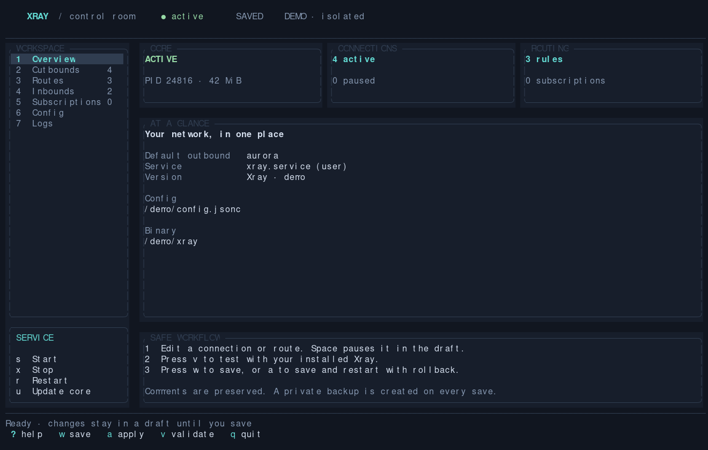

# Xray TUI

Локальная панель управления Xray для Linux с systemd, написанная на Rust / Ratatui. Тёмный интерфейс, клавиатурная навигация, черновик настроек и проверка установленным ядром перед сохранением.



Для сборки нужен Rust с Cargo, для управления подключениями — установленный Xray и его systemd unit.

```bash
git clone https://github.com/kimifish/xray-tui.git
cd xray-tui
cargo build --release
./target/release/xray-tui
```

После сборки можно запускать `./xray-tui` из каталога проекта либо этот launcher по абсолютному пути из любого каталога.

Клиент автоматически определяет пользовательский или системный `xray.service`, путь к бинарнику и единственному конфигу по unit и аргументам процесса. Открытие клиента не меняет конфиг и состояние сервиса. Для знакомства с интерфейсом без доступа к сервису запустите `./xray-tui --demo`.

Для другого сервиса или установки:

```bash
./target/release/xray-tui --service xray.service --system \
  --config /usr/local/etc/xray/config.jsonc --binary /usr/local/bin/xray
```

Клиент работает с правами запустившего его пользователя. Для системных установок нужны права записи в конфиг/каталог бинарника и права управления соответствующим unit. Клиент не запускает `sudo` и не меняет polkit. Поддерживается один файл конфигурации; установки с `-confdir` требуют осознанного выбора файла через `--config`.

## Разделы

* **Overview** — состояние systemd, PID, память, версия, пути, текущий default outbound.
* **Outbounds** — создание из JSON/JSONC или share-ссылки, редактирование JSONC, приоритет, выбор default, временное отключение.
* **Routes** — форма имени, outbound, доменов, IP/CIDR/geoip, портов, сети, inbound-тегов и протоколов; редактирование произвольных полей через JSONC; порядок правил и временное отключение.
* **Inbounds** — локальные слушатели, настройки протоколов и временное отключение.
* **Subscriptions** — приватные HTTPS URL, предварительный просмотр импорта, обновление выбранного источника или всех источников.
* **Config** — редактирование любой секции и полного `config.jsonc`, включая DNS, logging, policy, sniffing, balancers и дополнительные настройки Xray.
* **Logs** — последние 200 записей systemd journal по запросу.

## Клавиши

| Клавиша | Действие |
|---|---|
| `1`–`7`, `Tab`, `Shift-Tab` | Переключить раздел |
| `j/k`, `↑/↓` | Выбрать элемент |
| `/`, `Esc` | Фильтровать список / убрать фильтр |
| `n`, `i` | Создать элемент / импортировать outbounds |
| `Enter`, `e` | Форма маршрута / JSONC выбранного элемента |
| `Space` | Отключить или вернуть элемент в черновике |
| `J/K` | Изменить порядок; первое совпадение маршрута имеет приоритет |
| `d` | Сделать выбранный outbound выходом по умолчанию |
| `t` / `T` в Outbounds | Проверить выбранный / все включённые outbounds |
| `Ctrl-T` в Outbounds | Расширенный тест выбранного outbound |
| `p` / `h` / `H` в Outbounds | Пауза автопроверок / подробный отчёт / настройки проверок |
| `Delete` | Удалить элемент после подтверждения |
| `E` | Редактировать весь конфиг |
| `v` | Проверить черновик установленным Xray |
| `w` | Проверить, создать backup и сохранить без перезапуска |
| `a` | Проверить, сохранить и перезапустить с откатом при сбое запуска |
| `R` | Перечитать файл и отбросить черновик после подтверждения |
| `s/x/r` | Запустить / остановить / перезапустить сохранённую конфигурацию |
| `u` | Проверить официальный релиз Xray; в Subscriptions — обновить источник |
| `U` в Subscriptions | Обновить все источники |
| `l/r` в Logs | Загрузить журнал |
| `PgUp/PgDn` | Прокрутить подробности / журнал |
| `?`, `q` | Справка / выход с проверкой несохранённых изменений |

В редакторах работают вставка из буфера, стрелки, Home/End, Backspace/Delete, `Ctrl-U` для очистки, `Ctrl-S` для принятия изменений в черновик и `Esc` для отмены. В формах `Tab` и `↑/↓` переключают поля; в поле outbound маршрута `F2` перебирает активные подключения. Подтверждение действий — `y`, отмена — `n` или `Esc`.

## Сохранение и отключение

Редактирование объектов использует concrete syntax tree JSONC. Формы сохраняют комментарии неизменённых полей; JSONC-редактор принимает комментарии, добавленные вручную. Полный редактор позволяет изменить весь исходный текст. При замене поля/массива комментарии внутри заменяемого значения определяются его новым текстом.

Отключённые объекты, позиции восстановления и подписки хранятся в одной строке-комментарии:

```jsonc
// @xray-tui:v1 {"disabled":[],"subscriptions":[]}
```

Эти метаданные игнорируются Xray. Они могут содержать ключи отключённых подключений и приватные URL подписок, поэтому файл и его backups сохраняются с правами `0600`. Известные поля с учётными данными маскируются в обычном просмотре; редакторы показывают исходные значения.

Первый outbound задаёт выход по умолчанию. Перед его отключением выберите другой через `d`. Используемое подключение нельзя отключить/удалить, пока активные маршруты, DNS, balancer или proxy chain ссылаются на его тег. Сначала отключите или измените соответствующие правила. Простые формы маршрутов работают с outbound; правила с `balancerTag`, regexp с запятыми и дополнительные поля удобнее редактировать через `e`.

Перед записью выполняется `xray run -test`. Сравнение с прочитанным файлом защищает от перезаписи обнаруженных внешних изменений. Запись атомарная, backup расположен рядом с конфигом. При неудачном старте после `a` клиент возвращает старый файл и пробует восстановить прежний сервис. Проверка запуска означает стабильное состояние `active/running` в течение короткого окна, а не проверку доступности каждого удалённого сервера. Первоначальные неразрешённые routing-теги сохраняются, новые отсутствующие назначения в черновике отклоняются.

## Импорт подписок

Поддерживаются:

* JSON/JSONC outbound, массив объектов или объект с `outbounds`;
* списки share-ссылок, включая base64-обёртку;
* VLESS, VMess, Trojan, Shadowsocks SIP002, SOCKS и HTTP;
* TCP/RAW, WebSocket, gRPC, HTTPUpgrade, XHTTP; TLS и Reality.

В Subscriptions нажмите `n`, укажите имя и HTTPS URL, затем `Ctrl-S`, `u` и просмотрите результат. Подтвердите импорт через `y`, после чего сохраните/примените черновик. Узлы получают имена `имя подписки / имя узла`. Повторное обновление заменяет только узлы этого источника; выключенные остаются выключенными. Исчезнувшие узлы сохраняются, если они default или используются активными правилами. Удаление источника оставляет импортированные подключения как ручные.

Clash YAML, Hysteria/TUIC share-ссылки и Shadowsocks plugins не конвертируются. Неподдерживаемый узел отклоняет весь импорт, сохраняя черновик. Произвольные возможности ядра доступны через импорт полноценного Xray JSONC.

## Обновление ядра

`u` вне Subscriptions обращается к [официальным GitHub Releases XTLS/Xray-core](https://github.com/XTLS/Xray-core/releases), показывает версию и платформенный asset. После подтверждения скачиваются ZIP и `.dgst`, проверяется SHA-256, извлекается только бинарник `xray`, кандидат проверяет сохранённый конфиг. Установка требует отдельного подтверждения: старый бинарник сохраняется рядом, замена атомарная, активный сервис перезапускается. При сбое запуска старый бинарник восстанавливается. Остановленный сервис после обновления остаётся остановленным.

Существующие geodata, unit и конфиг не заменяются. Источник установки — официальный релиз, без выполнения сетевого install-скрипта. Поддержаны Linux x86_64, aarch64, x86, riscv64. Запросы HTTPS используют proxy-настройки окружения и ограничены временем и размером ответа.

## Проверка outbounds

Каждая проверка запускает отдельный временный Xray с локальным SOCKS-входом, случайными учётными данными и принудительным маршрутом в выбранный outbound. Основной сервис и рабочие слушатели не меняются. Сохраняются DNS, bootstrap hosts, цепочки outbounds, socket options, default outbound и правила внутренней маршрутизации. API, observatory, reverse и исходные inbounds в проверяющем процессе не запускаются; логи и временный конфиг находятся в приватном каталоге и удаляются после проверки.

Проверка выполняет настоящие HTTPS GET через SOCKS5h, без использования proxy-переменных окружения и без перехода по redirects. Проверяются TLS-сертификат, ожидаемый HTTP-код, размер и заданный фрагмент тела ответа. Каждый запрос использует новое HTTPS-соединение. `Ctrl-T` выполняет три цикла с новым экземпляром ядра в каждом цикле, затем проверяет передачу 512 КиБ. Открытого TCP-порта недостаточно для статуса OK.

По умолчанию проверяются Google `generate_204` и Cloudflare `cdn-cgi/trace`. Периодические проверки включены, работают пока открыт TUI и основной сервис активен, используют сохранённый файл и повторяются примерно раз в 60 секунд с отклонением ±20%. Очередь допускает максимум две проверки одновременно; повторные задания для того же outbound не накапливаются. Новые подключения, изменение файла и бинарника учитываются при следующих проверках. При остановленном основном сервисе остаётся доступна ручная проверка конфигурации. При выходе фоновые проверки отменяются, процессы завершаются; уже начатый HTTPS-запрос может ждать своего таймаута.

`t` проверяет выбранный элемент текущего черновика; `T` — включённые элементы черновика. Отключённый outbound можно вручную проверить, не включая его в рабочем конфиге. Такие результаты отмечаются `Draft`, результаты сохранённой конфигурации — `Saved`. Blackhole, DNS и Loopback показываются как `N/A`: они не предназначены для обычного веб-запроса. Конфигурации с WireGuard `kernelMode` и outbound `sendThrough: origin/srcip` требуют исходного сетевого контекста и не могут быть достоверно проверены этим изолированным режимом.

В Outbounds отдельно показываются состояние включения и результат последней проверки:

| Индикация | Значение |
|---|---|
| `✓ OK · … ms` | Все цели доступны; задержка — медиана полного HTTPS-запроса, не ping |
| `~ Partial · 1/2` | Часть целей недоступна или первый/второй полностью неудачный цикл |
| `! Failed · 3×` | Три полностью неудачных цикла подряд |
| `~ Recovering · 1/2` | Первый успешный цикл после устойчивого отказа; второй возвращает OK |
| `↻ Checking` / `… Queued` | Идёт проверка / ожидание слота |
| `? Unknown` / `? Stale` | Нет результата для этой конфигурации / результат старше двух интервалов |

`h` открывает отчёт с результатом каждой цели, этапом сбоя, последней ошибкой и историей 20 циклов. В отчёте работают стрелки и PgUp/PgDn. Таймаут, сброс или TLS-ошибка не являются доказательством DPI: возможны проблемы DNS, сети, сервера и настроек транспорта. Успех на контрольных целях также не доказывает доступность любого сайта. Собственные цели можно настроить через `H`.

`H` открывает JSONC настроек: `enabled`, `interval_seconds`, `timeout_seconds`, `concurrency`, `targets`, `extended_target` и необязательный `ca_certificate` для своего центра сертификации. Каждая цель содержит `name`, `url`, ожидаемый `status`, необязательный `contains` и границы `min_bytes`/`max_bytes`. Допустимы только HTTPS, таймаут 2–30 секунд, интервал 15–86400 секунд и 1–2 одновременные проверки; тело ограничено 1 МиБ. Проверку сертификатов отключить нельзя. `Ctrl-S` принимает настройки в черновик; `w` сохраняет их в комментарии `config.jsonc`. `p` сразу меняет периодический режим, а `w` сохраняет это предпочтение между запусками.

История сохраняется отдельно в `$XDG_STATE_HOME/xray-tui/health-<id>.json` (обычно `~/.local/state/xray-tui/`), с правами каталога `0700` и файла `0600`. Там хранятся имена узлов, отпечаток конфигурации, времена и результаты; конфиги, URL целей, пароли, тела ответов и сырые логи Xray не сохраняются. Изменение конфигурации, зависимостей, параметров проверки или бинарника инвалидирует старый результат. История ограничена 20 циклами на отпечаток и 128 записями.

Пауза отменяет очередь и начатые автоматические проверки после завершения текущего запроса или его таймаута. Ручные задания продолжаются. Отменённые циклы не считаются неудачными.

Экран перерисовывается при вводе и изменении состояния. Возраст результатов обновляется раз в секунду на вкладке Outbounds и в отчёте; неизменный экран не перерисовывается. Разобранный JSONC и отпечатки подключений кешируются с учётом правок и сохранения черновика. Изменения бинарника и CA-файла проверяются каждые 5 секунд, а перед ручной проверкой — сразу. Для обновления клиента достаточно перезапустить TUI; перезапуск Xray не требуется.

Для разовой проверки из командной строки без входа в TUI и без сохранения истории:

```bash
./xray-tui --probe my-proxy
./xray-tui --probe my-proxy --extended
./xray-tui --probe-all
```

Результат выводится в JSON. При неуспешных проверках команда возвращает ненулевой exit code.

## Проверка и демо

```bash
cargo test
cargo clippy --all-targets -- -D warnings
./target/release/xray-tui --check
./target/release/xray-tui --check-update
cargo run --example verify_update  # скачать и проверить кандидат без установки
./target/release/xray-tui --demo
./target/release/xray-tui --demo --snapshot /tmp/xray-tui.svg
python3 tests/pty_smoke.py ./target/release/xray-tui
python3 tests/idle_cpu.py ./target/release/xray-tui --config ~/.config/xray/config.jsonc
XRAY_TEST_BINARY=/path/to/xray cargo test --test health_live
```

В demo отключены действия с сервисом, запись рабочего конфига и сетевые запросы. Тесты сохранения, отката и обновления используют поддельный systemd и бинарники во временных каталогах. Реальный сервис не останавливается и не перезапускается тестами.

`idle_cpu.py` измеряет CPU в отдельном PTY на вкладке Outbounds с паузой и историей результатов. Он использует приватную копию конфига, поддельные systemd/core и временную историю; допустимая нагрузка по умолчанию — менее 2% одного ядра. Доступ к рабочему конфигу нужен только для чтения.

Официальные справочники: [конфигурация](https://xtls.github.io/en/config/), [маршрутизация](https://xtls.github.io/en/config/routing.html), [установка](https://xtls.github.io/en/document/install.html).

## Лицензия

[MIT](LICENSE).
